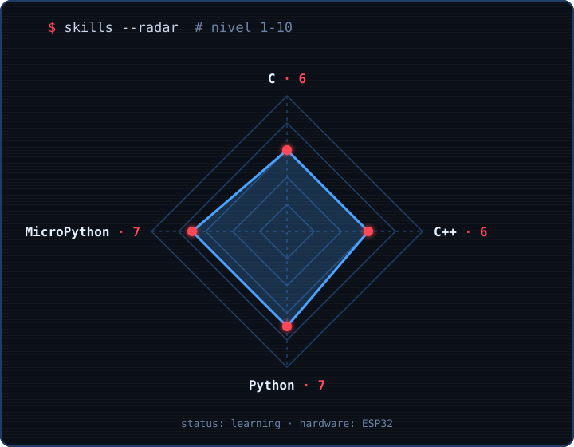

---

## `$ whoami`

  

## `$ cat tech-stack.yaml`

| `├─ ⚙ lenguajes:` | `╰─ 🔌 hardware:` |
| :---: | :---: |
|  |  &nbsp;  |
| `C · C++ · Python` | `MicroPython · ESP32` |

## `$ skills --radar`

  

## `$ git log --stats`

  
  

## `$ connect --socials`

---

Hecho con ☕ y estaño desde Pereira, Colombia · @Soros6999

